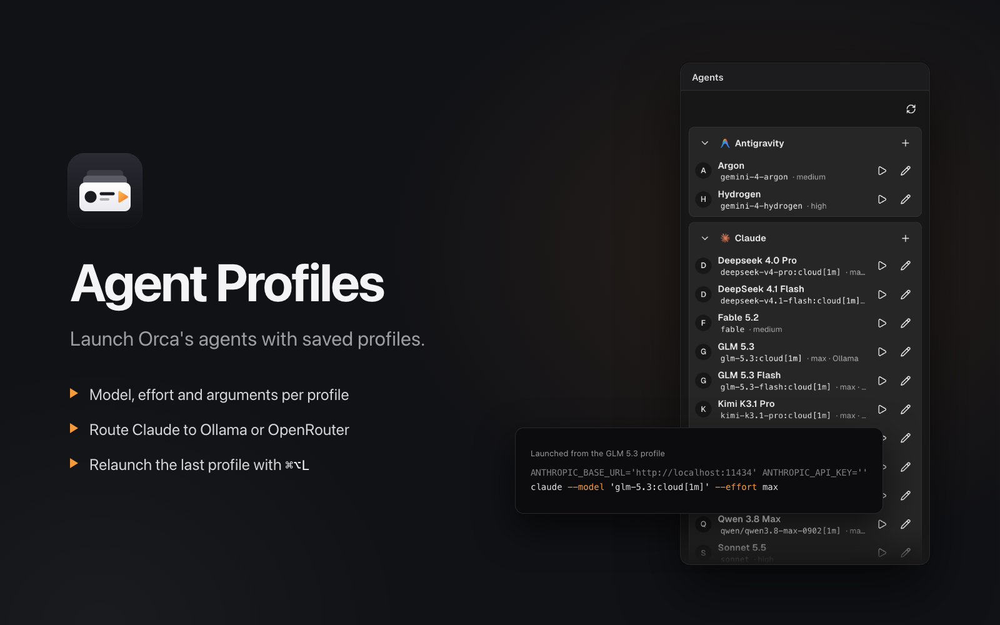

# Agent Profiles

**Launch Orca's coding agents with saved profiles: model, effort, extra arguments and, for Claude, a third-party provider such as Ollama or OpenRouter.**

  

[Install](#install) · [Features](#features) · [Routing](#how-routing-works) · [Access](#what-it-can-access) · [Limits](#requirements-and-limits) · [Development](#development)



Orca lets you pick an agent, but every launch starts from the same command. Agent Profiles adds an **Agents** panel where each agent you enabled in Orca gets its own group of profiles: *Opus on high effort*, *DeepSeek through Ollama*, *Codex with a custom config*. One click on ▷ launches the profile in the active workspace.

## Install

From the Orca plugin directory:

[Open in Orca](https://orca.dev/plugins/erom.agent-profiles?catalog=community)

Or from the command line:

```sh
orca plugin install eRom/orca-plugin-agent-profiles
```

Orca shows the access the plugin asks for (see [What it can access](#what-it-can-access)) and enables it once you approve. The panel then appears in the right sidebar under the robot icon.

## Features

- **One group per enabled agent**, sorted alphabetically. A chevron collapses or expands a group, and the collapsed state is remembered across Orca restarts. The groups follow Orca's theme, custom themes included.
- **Profiles** show an avatar or a monogram, the name, a "model · effort · provider" summary, and a badge on the last profile launched. ▷ launches, ✎ edits.
- **The form adapts to the agent**: model and effort fields appear only when the agent accepts them (Claude, Codex, Grok, Antigravity, Pi, CodeBuddy and others), extra arguments always.
- **Providers for Claude**: a base URL, a token and extra environment variables, shared between profiles. Any Anthropic-compatible endpoint works (Ollama, OpenRouter, a local gateway).
- **Relaunch the last profile** with `Mod+Alt+L` or the command *Agents: relaunch last profile*, whatever its agent.
- **Avatars**: bundled agent icons and model brand icons, picked in the profile form.

The interface follows Orca's language: French when Orca is set to French, English otherwise.

## How routing works

When you launch a profile, the plugin's `agent.launch.before` hook rewrites the agent's command: it removes any model or effort flag already set in Orca's settings, then adds the profile's own flags and extra arguments. An effort left on *Orca's default* leaves the command untouched.

For Claude with a provider, any launch whose `--model` matches the profile is routed to that provider, wherever it comes from (command palette, CLI, automation):

```sh
orca agent launch --agent claude --model 'deepseek-v4.1-flash:cloud[1m]'
```

Other agents are never modified outside the panel.

### Tokens

A token written as `$NAME` (for example `$OPENROUTER_API_KEY`) is never read by the plugin. It becomes an assignment at the head of the command, expanded by the terminal's shell, which reads your `~/.zshenv`: the key never passes through the plugin or Orca. If the variable is missing, the shell refuses to start Claude and names it.

A literal token is accepted but stored in clear in the plugin's storage, and passed only through the launch environment, never on the command line. The form warns about it.

## What it can access

Orca labels this plugin **Full access**: it runs its own worker process on your machine with your user's rights. Here is exactly what it does with that.

| Capability | Why |
| --- | --- |
| `workspace:read` | Know the active workspace to launch a profile in it. |
| `workspace:write` | Focus the terminal of the agent it just launched (Orca opens it in the background otherwise). |
| `agent:launch` | Launch agents from the panel and rewrite their command in the launch hook. |
| `storage:own` | Keep profiles, providers and panel state in the plugin's own storage. |

Beyond Orca's API, the worker:

- **reads** Orca's settings database (`~/Library/Application Support/orca/profiles/<id>/profile-state.db`) to know which agents you enabled. It never writes to it.
- **runs one command**: a single `zsh -ilc` that looks up each known agent's executable with your real `PATH`.
- **makes no network request** and collects no data.

## Requirements and limits

- **macOS only**: the plugin reads Orca's settings from `~/Library/Application Support/orca`.
- **Orca 1.4.248 or later**, and `zsh` as the login shell for agent detection. If the login shell fails or takes more than 15 seconds, the plugin falls back to the worker's `PATH`, which is less complete.
- **No plugin API lists Orca's enabled agents**, so the plugin reads Orca's internal settings format. If that format changes, it falls back to showing every installed agent instead of failing.
- **Toggling an agent** in Settings > Agents is not picked up live: press ⟳ in the panel.
- **The agent table** (commands, model and effort flags) is bundled in `src/agents.ts` and must be updated when Orca adds or changes an agent.
- **No prompt at launch**: Orca does not pass a prompt given by a plugin to the agent.
- **Resumed and restored sessions are not routed**: Orca does not send them through the launch hook, so they start without the profile.
- **A native launch of the same agent** within 15 seconds of a panel launch whose profile was not yet consumed may receive that profile.

## Development

```sh
orca plugin dev load .     # run the folder in Orca, writes the typings to .orca/types
orca plugin test . --json  # unit tests
bunx tsc -p .              # type check
orca plugin validate . --json
orca plugin check . --json
```

In development mode, Orca ties the approval to the folder's content: any file change disables the plugin until you approve it again. For daily use, install a frozen copy with `orca plugin install .`.

## Credits

- Agent icons come from [Orca](https://github.com/stablyai/orca) (MIT), see [`agent-icons/SOURCES.md`](agent-icons/SOURCES.md).
- Model avatars come from [Lobe Icons](https://github.com/lobehub/lobe-icons) (MIT), see [`avatars/SOURCES.md`](avatars/SOURCES.md). Brand icons are trademarks of their respective owners and only identify a provider or model.

Agent Profiles is a community plugin, not made or endorsed by Stably or by any of the agent vendors.

## License

[MIT](LICENSE)
